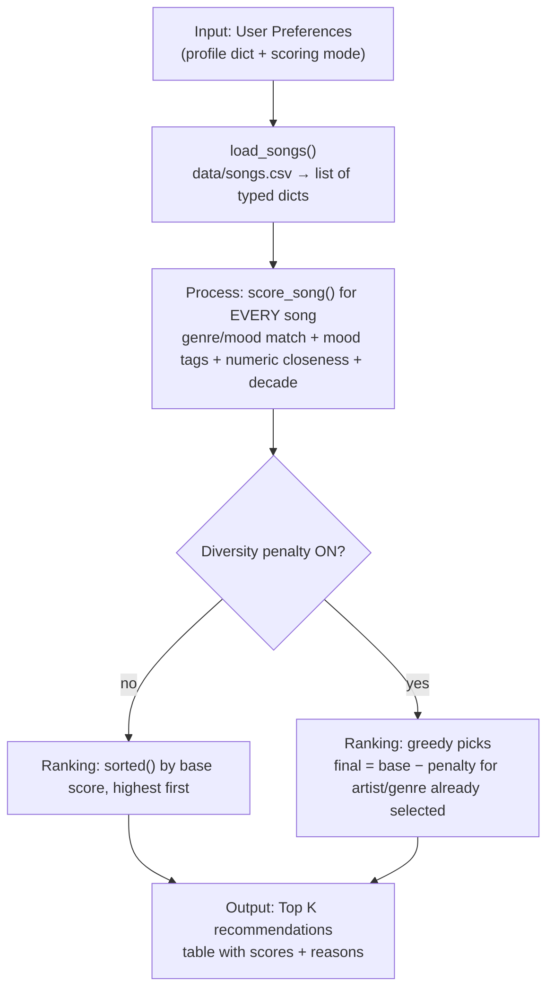

# 🎵 Music Recommender Simulation

## Project Summary

This project is a small, **CLI-first, content-based music recommender**. It loads a catalog of 20 simulated songs from `data/songs.csv`, compares each song with a user's "taste profile," gives every song a score with a plain-language explanation, and prints the top recommendations as a table in the terminal.

My version adds:

- **15 song attributes**, including 5 advanced attributes (popularity, release decade, instrumentalness, liveness and detailed mood tags).
- **4 scoring modes** (balanced, genre-first, mood-first, energy-focused) that you can switch from the command line.
- A **diversity penalty**, so the top 5 is not filled with one artist or one genre.
- A **summary table** that shows every point a song earned.
- **7 test profiles** (3 normal listeners, 3 edge cases and the default), plus a weight-shift experiment.

The evaluation, biases and reflection are in the [Model Card](model_card.md). The AI workflow is documented in [ai_interactions.md](ai_interactions.md).

---

## How The System Works

### How real recommenders work (Phase 1 research)

Large platforms like Spotify and YouTube combine many signals. This simulation uses only a few of them. Two families of methods matter most:

- **Collaborative filtering** uses the behavior of *other users*. If many people who play song A also play song B, B can be recommended to a new listener of A, even if the system knows nothing about how the songs sound. Matrix factorization is a well-known way to do this. It learns hidden "taste" factors for users and items from a large table of interactions (Koren, Bell & Volinsky, 2009).
- **Content-based filtering** uses the *attributes of the item itself*, such as genre, tempo, mood and energy. It recommends items similar to what the user already liked. It works for a brand-new song nobody has played yet, but it tends to recommend "more of the same."
- **Hybrid systems** combine both, often in stages. Google's published description of YouTube's recommender uses two stages. A *candidate generation* model first narrows millions of videos down to a few hundred. A separate *ranking* model then scores those candidates using many features (Covington, Adams & Sargin, RecSys 2016). YouTube's own blog says its system learns from a very large number of "signals." The post covers watch behavior and satisfaction as well as clicks (Goodrow, 2021).
- **Data involved.** Spotify's public "Understanding recommendations" page says your recommendations are shaped by your engagement with content and by information you share. It also says editors' curation and commercial considerations can play a role, and that "not interested" feedback reduces similar suggestions. In general, behavioral signals include likes, skips, saves, playlist adds, follows and listening history. Content signals include genre, tempo, mood, energy and audio features. *These are examples of the kinds of data recommenders use; I am not claiming any platform uses a specific formula.*

**How this simulation is different:** it is purely **content-based**. It has a hand-written scoring rule, one user at a time, no learning, no other users and no listening history. It only compares song attributes with stated preferences. That makes every recommendation fully explainable, but it cannot discover tastes the user did not type in.

Sources:
[Spotify – Understanding recommendations](https://www.spotify.com/uk/safetyandprivacy/understanding-recommendations) ·
[Covington et al., "Deep Neural Networks for YouTube Recommendations" (RecSys 2016)](https://research.google/pubs/pub45530/) ·
[YouTube Official Blog – "On YouTube's recommendation system" (2021)](https://blog.youtube/inside-youtube/on-youtubes-recommendation-system/) ·
Koren, Bell & Volinsky, "Matrix Factorization Techniques for Recommender Systems," *IEEE Computer* 42(8), 2009.

### What this simulation prioritizes

It treats **genre and mood** as the strongest signals of taste. **Energy** is the most important number. Other attributes act as tie-breakers that separate songs which match on genre and mood. It also cares that every point is **explainable**: each reason in the output shows exactly how many points it added.

### Dataset features (Phase 1 Step 2 + Challenge 1)

`data/songs.csv` has **20 songs**: the 10 original starter songs plus 10 new ones. All titles, artists and values are **simulated** (fictional artists, invented popularity numbers). Nothing describes a real artist or real chart data.

| Column | Type | Kind | Used for scoring? | Why it is useful |
|---|---|---|---|---|
| id, title | int, text | identifier | no | identify and display the song |
| artist | text | categorical | diversity penalty only | avoid repeating one artist |
| genre | text | categorical | **yes**: exact match | strongest single taste signal |
| mood | text | categorical | **yes**: exact match | what the listener wants to feel |
| energy | float 0–1 | numeric | **yes**: closeness | calm vs. intense; separates the catalog well |
| tempo_bpm | float | numeric | yes: closeness (range 120 BPM) | slow vs. fast |
| valence | float 0–1 | numeric | yes: closeness | sad/dark (0) vs. bright/happy (1) |
| danceability | float 0–1 | numeric | yes: closeness | groove |
| acousticness | float 0–1 | numeric | yes: closeness | acoustic vs. electronic |
| **popularity** *(new)* | int 0–100 | numeric | yes: closeness | mainstream vs. niche |
| **release_decade** *(new)* | int (1970…2020) | ordinal | yes: same decade / neighbouring decade | era preference |
| **instrumentalness** *(new)* | float 0–1 | numeric | yes: closeness | vocals vs. instrumental (e.g. study music) |
| **liveness** *(new)* | float 0–1 | numeric | yes: closeness | studio vs. live-concert feel |
| **mood_tags** *(new)* | list of text (`;`-separated) | categorical (multi-label) | yes: share of tags matched | finer mood detail than one mood word |

I chose **genre, mood, energy and valence** as the core features. Genre and mood capture the "kind" of song a person asks for. Energy and valence are the two numbers that differ most between, for example, a lofi study track (energy 0.35–0.42) and a gym track (0.93). Danceability and acousticness are useful but overlap with energy, so they get smaller weights.

### Song and UserProfile

- **`Song`** (dataclass in `src/recommender.py`) holds every column above. The 5 new fields have defaults, so older code that builds a Song with only the original 10 fields still works.
- **`UserProfile`** stores `favorite_genre`, `favorite_mood`, `target_energy` and `likes_acoustic`, plus optional targets: `target_valence`, `target_danceability`, `target_tempo_bpm`, `target_instrumentalness`, `target_liveness`, `target_popularity`, `preferred_decade` and `preferred_mood_tags`. `to_prefs()` turns it into the dictionary that `score_song` uses.
- The CLI profiles are plain dictionaries whose keys match the song columns (`"genre"`, `"energy"`, `"mood_tags"`, …). A **missing key means "no preference"**: that feature earns no points for any song.

**Default profile** (used by `python -m src.main`):

```python
{"genre": "pop", "mood": "happy", "energy": 0.8, "valence": 0.8, "danceability": 0.8,
 "likes_acoustic": False, "mood_tags": ["uplifting", "sunny", "carefree"],
 "popularity": 75, "release_decade": 2010}
```

It can tell different tastes apart. "Pop" alone would rank *Gym Hero* (pop, intense) and *Sunrise City* (pop, happy) about the same. Mood, valence and mood tags separate a cheerful pop fan from a workout pop fan.

### Algorithm Recipe (finalized)

The recipe starts from the assignment's example (**+2.0 genre, +1.0 mood, energy-closeness points**) and extends it to the new features. For one song:

1. **Genre match:** `+weight` if the song's genre equals the user's genre. The match ignores upper/lower case and extra spaces.
2. **Mood match:** `+weight` if the moods are equal.
3. **Mood tags:** `weight × (tags matched ÷ tags the user listed)`.
4. **Numeric closeness** for each numeric target the user set:
   `similarity = 1 − |song value − target| ÷ range` (never below 0), then `points = weight × similarity`.
   The range is 1.0 for 0–1 features, 120 for tempo and 100 for popularity.
   This rewards **closeness, not size**. A song with energy 0.70 gets 100% similarity for a target of 0.70 but only 40% for a target of 0.10. `likes_acoustic=True/False` becomes an acousticness target of 0.8 or 0.2.
5. **Release decade:** full weight for the same decade, half weight for a neighbouring decade, 0 otherwise.
6. **Song score** = the sum of all the points. Each part is rounded to 2 decimals first, so the reasons always add up exactly to the score shown. If a song value is missing, that feature is skipped (no points, no crash).

Weights per scoring mode. **balanced** is the default:

| Feature | balanced | genre-first | mood-first | energy-focused |
|---|---|---|---|---|
| genre match | **2.0** | **4.0** | 0.5 | 0.5 |
| mood match | **1.0** | 0.5 | **3.0** | 0.5 |
| mood tags (max) | 1.0 | 0.5 | **2.0** | 0.25 |
| energy closeness | **1.5** | 0.75 | 0.75 | **4.0** |
| valence | 0.5 | 0.25 | 1.0 | 0.25 |
| danceability | 0.5 | 0.25 | 0.25 | 1.0 |
| acousticness | 0.5 | 0.25 | 0.25 | 0.5 |
| instrumentalness | 0.5 | 0.25 | 0.25 | 0.25 |
| tempo | 0.5 | 0.25 | 0.25 | 1.0 |
| liveness | 0.25 | 0.1 | 0.1 | 0.25 |
| popularity | 0.25 | 0.1 | 0.1 | 0.1 |
| release decade | 0.5 | 0.25 | 0.25 | 0.1 |

Why these balanced weights: genre (2.0) plus mood (1.0) can be worth up to 3.0, about one third of the maximum of roughly 9 points, so they matter most. Energy (1.5) is the strongest number because it best separates "calm" from "intense" songs in this catalog. The advanced features are worth at most 0.25–1.0 each. They break ties instead of overriding genre and mood.

### Scoring vs. ranking

- **Scoring** (`score_song`) looks at **one song** and answers "how well does this song fit this user?" It returns `(score, reasons)`.
- **Ranking** (`rank_songs` / `recommend_songs`) looks at **the whole catalog**. It scores every song, orders the songs from highest to lowest score and keeps the top `k`. Duplicate song ids are skipped so a song never appears twice. `k ≤ 0` returns an empty list, and a `k` larger than the catalog returns every song.
- `sorted(candidates, key=...)` returns a **new** sorted list and leaves the original alone. `candidates.sort(key=...)` would reorder the **same** list in place and return `None`. The code uses `sorted()` so the caller's song list is never reordered (a test checks this).

### Diversity penalty (Challenge 3)

When diversity is ON (the CLI default), the top `k` is chosen **one song at a time**:

1. Every song keeps its **base score** from `score_song`.
2. In each round, every remaining song gets a **diversity penalty** based on the songs **already selected**: −1.0 for each selected song by the same artist, and −0.5 for each selected song in the same genre. Songs with a blank artist are never treated as an artist repeat.
3. **Final ranking score = base score − penalty.** The song with the highest final score is picked (ties go to the higher base score, then the title A→Z).

The first pick is never penalized. A penalized song is not removed. It just has to beat the alternatives with a lower score. The table shows both the final score and `(base …)`, and the reasons list the penalty. Because penalties only grow as the list fills up, final scores still come out in descending order.

### Data flow



### Potential biases (short note)

Genre and mood are exact text matches. "indie pop" gets **no** credit for a "pop" fan, and a genre missing from the catalog ("k-pop") can never match. Lofi (4 songs) and pop (3 songs) have the most entries, while 11 of the 15 genres have only one song. Fans of those genres get one strong match and then filler. All advanced values are invented. See [Limitations and Bias](model_card.md#limitations-and-bias) for details.

---

## Scoring Modes (Challenge 2)

| Mode | Behaviour |
|---|---|
| `balanced` (default) | Starter recipe: genre +2.0, mood +1.0, energy closeness up to +1.5, small bonuses for everything else. |
| `genre-first` | Genre +4.0; everything else at about half weight. Matching-genre songs nearly always lead. |
| `mood-first` | Mood +3.0, mood tags up to +2.0, valence up to +1.0; genre only +0.5. Same-mood songs from other genres can rise above same-genre songs. |
| `energy-focused` | Energy up to +4.0, tempo and danceability up to +1.0; genre and mood only +0.5. It ranks by "intensity" more than by label. |

The modes use a simple **Strategy pattern**: each mode is a `ScoringMode` object (name, description, weights) in `SCORING_MODES`. `score_song(..., mode=...)` runs the *same* scoring steps with the chosen weights, so no scoring code is duplicated. Run `python -m src.main --list` to see them all.

---

## Getting Started

### Setup

1. Create a virtual environment (optional but recommended):

   ```bash
   python -m venv .venv
   source .venv/bin/activate      # Mac or Linux
   .venv\Scripts\activate         # Windows
   ```

2. Install dependencies:

   ```bash
   pip install -r requirements.txt
   ```

3. Run the app:

   ```bash
   python -m src.main
   ```

### Command line options

```bash
python -m src.main                              # default Happy Pop profile, balanced mode, diversity ON
python -m src.main --mode mood-first            # switch scoring mode (balanced | genre-first | mood-first | energy-focused)
python -m src.main --profile chill-lofi         # pick a profile (see --list), or --profile all
python -m src.main --no-diversity               # turn the diversity penalty off
python -m src.main -k 3                         # change how many songs are shown
python -m src.main --compare-modes              # one profile, all four modes side by side
python -m src.main --diversity-demo --profile chill-lofi   # top 5 without vs with diversity
python -m src.main --experiment                 # weight-shift experiment (energy x2, genre x0.5)
python -m src.main --list                       # list profiles and modes
```

### Running Tests

```bash
python -m pytest
```

There are 25 tests in `tests/test_recommender.py` (the starter OOP tests) and `tests/test_scoring.py`. They cover CSV loading, type conversion, missing and invalid data, genre/mood scoring, numeric closeness, score = sum of reasons, ordering, top-k, scoring modes, the diversity penalty and the CLI commands.

---

## Sample Recommendation Output

Real output of `python -m src.main` (default profile, balanced mode, diversity ON). The "Why" column lists every point the song earned and any diversity penalty:

```text
$ python -m src.main
Loaded 20 songs from data/songs.csv

=== Profile: Default: Happy Pop ===
Preferences : genre=pop, mood=happy, energy=0.8, valence=0.8, danceability=0.8, likes_acoustic=False, mood_tags=['uplifting', 'sunny', 'carefree'], popularity=75, release_decade=2010
Scoring mode: balanced | Diversity penalty: ON | Top 5
+----+------------------------+--------------+--------------+----------------------------------------------------------------+
| #  | Song                   | Genre / Mood | Score        | Why (points earned)                                            |
+====+========================+==============+==============+================================================================+
| 1  | Sunrise City           | pop          | 7.67         | genre match: pop (+2.00)                                       |
|    | by Neon Echo           | happy        |              | mood match: happy (+1.00)                                      |
|    |                        |              |              | mood tags uplifting, sunny, carefree (3/3) (+1.00)             |
|    |                        |              |              | energy 0.82 vs target 0.8 (98% similar) (+1.47)                |
|    |                        |              |              | valence 0.84 vs target 0.8 (96% similar) (+0.48)               |
|    |                        |              |              | danceability 0.79 vs target 0.8 (99% similar) (+0.49)          |
|    |                        |              |              | popularity 78 vs target 75 (97% similar) (+0.24)               |
|    |                        |              |              | acousticness 0.18 vs target 0.2 (98% similar) (+0.49)          |
|    |                        |              |              | from the 2010s (+0.50)                                         |
+----+------------------------+--------------+--------------+----------------------------------------------------------------+
| 2  | Bubblegum Skies        | pop          | 5.46         | genre match: pop (+2.00)                                       |
|    | by Neon Echo           | happy        | (base 6.96)  | mood match: happy (+1.00)                                      |
|    |                        |              |              | mood tags sunny, carefree (2/3) (+0.67)                        |
|    |                        |              |              | energy 0.85 vs target 0.8 (95% similar) (+1.43)                |
|    |                        |              |              | valence 0.9 vs target 0.8 (90% similar) (+0.45)                |
|    |                        |              |              | danceability 0.84 vs target 0.8 (96% similar) (+0.48)          |
|    |                        |              |              | popularity 85 vs target 75 (90% similar) (+0.23)               |
|    |                        |              |              | acousticness 0.1 vs target 0.2 (90% similar) (+0.45)           |
|    |                        |              |              | from the 2020s (next to 2010s) (+0.25)                         |
|    |                        |              |              | diversity penalty: artist Neon Echo already listed 1x (-1.00)  |
|    |                        |              |              | diversity penalty: genre pop already listed 1x (-0.50)         |
+----+------------------------+--------------+--------------+----------------------------------------------------------------+
| 3  | Rooftop Lights         | indie pop    | 5.26         | mood match: happy (+1.00)                                      |
|    | by Indigo Parade       | happy        |              | mood tags uplifting, carefree (2/3) (+0.67)                    |
|    |                        |              |              | energy 0.76 vs target 0.8 (96% similar) (+1.44)                |
|    |                        |              |              | valence 0.81 vs target 0.8 (99% similar) (+0.49)               |
|    |                        |              |              | danceability 0.82 vs target 0.8 (98% similar) (+0.49)          |
|    |                        |              |              | popularity 73 vs target 75 (98% similar) (+0.24)               |
|    |                        |              |              | acousticness 0.35 vs target 0.2 (85% similar) (+0.43)          |
|    |                        |              |              | from the 2010s (+0.50)                                         |
+----+------------------------+--------------+--------------+----------------------------------------------------------------+
| 4  | Gym Hero               | pop          | 4.39         | genre match: pop (+2.00)                                       |
|    | by Max Pulse           | intense      | (base 5.39)  | energy 0.93 vs target 0.8 (87% similar) (+1.30)                |
|    |                        |              |              | valence 0.77 vs target 0.8 (97% similar) (+0.48)               |
|    |                        |              |              | danceability 0.88 vs target 0.8 (92% similar) (+0.46)          |
|    |                        |              |              | popularity 82 vs target 75 (93% similar) (+0.23)               |
|    |                        |              |              | acousticness 0.05 vs target 0.2 (85% similar) (+0.42)          |
|    |                        |              |              | from the 2010s (+0.50)                                         |
|    |                        |              |              | diversity penalty: genre pop already listed 2x (-1.00)         |
+----+------------------------+--------------+--------------+----------------------------------------------------------------+
| 5  | Concrete Poetry        | hip hop      | 3.56         | energy 0.78 vs target 0.8 (98% similar) (+1.47)                |
|    | by Verse Theory        | confident    |              | valence 0.62 vs target 0.8 (82% similar) (+0.41)               |
|    |                        |              |              | danceability 0.86 vs target 0.8 (94% similar) (+0.47)          |
|    |                        |              |              | popularity 75 vs target 75 (100% similar) (+0.25)              |
|    |                        |              |              | acousticness 0.12 vs target 0.2 (92% similar) (+0.46)          |
|    |                        |              |              | from the 2010s (+0.50)                                         |
+----+------------------------+--------------+--------------+----------------------------------------------------------------+
```

The same profile **with the diversity penalty off**. Gym Hero is now #3 ahead of Rooftop Lights, because nothing penalizes the third pop song:

```text
$ python -m src.main --no-diversity -k 4
Loaded 20 songs from data/songs.csv

=== Profile: Default: Happy Pop ===
Preferences : genre=pop, mood=happy, energy=0.8, valence=0.8, danceability=0.8, likes_acoustic=False, mood_tags=['uplifting', 'sunny', 'carefree'], popularity=75, release_decade=2010
Scoring mode: balanced | Diversity penalty: OFF | Top 4
+----+------------------------+--------------+--------------+----------------------------------------------------------------+
| #  | Song                   | Genre / Mood | Score        | Why (points earned)                                            |
+====+========================+==============+==============+================================================================+
| 1  | Sunrise City           | pop          | 7.67         | genre match: pop (+2.00)                                       |
|    | by Neon Echo           | happy        |              | mood match: happy (+1.00)                                      |
|    |                        |              |              | mood tags uplifting, sunny, carefree (3/3) (+1.00)             |
|    |                        |              |              | energy 0.82 vs target 0.8 (98% similar) (+1.47)                |
|    |                        |              |              | valence 0.84 vs target 0.8 (96% similar) (+0.48)               |
|    |                        |              |              | danceability 0.79 vs target 0.8 (99% similar) (+0.49)          |
|    |                        |              |              | popularity 78 vs target 75 (97% similar) (+0.24)               |
|    |                        |              |              | acousticness 0.18 vs target 0.2 (98% similar) (+0.49)          |
|    |                        |              |              | from the 2010s (+0.50)                                         |
+----+------------------------+--------------+--------------+----------------------------------------------------------------+
| 2  | Bubblegum Skies        | pop          | 6.96         | genre match: pop (+2.00)                                       |
|    | by Neon Echo           | happy        |              | mood match: happy (+1.00)                                      |
|    |                        |              |              | mood tags sunny, carefree (2/3) (+0.67)                        |
|    |                        |              |              | energy 0.85 vs target 0.8 (95% similar) (+1.43)                |
|    |                        |              |              | valence 0.9 vs target 0.8 (90% similar) (+0.45)                |
|    |                        |              |              | danceability 0.84 vs target 0.8 (96% similar) (+0.48)          |
|    |                        |              |              | popularity 85 vs target 75 (90% similar) (+0.23)               |
|    |                        |              |              | acousticness 0.1 vs target 0.2 (90% similar) (+0.45)           |
|    |                        |              |              | from the 2020s (next to 2010s) (+0.25)                         |
+----+------------------------+--------------+--------------+----------------------------------------------------------------+
| 3  | Gym Hero               | pop          | 5.39         | genre match: pop (+2.00)                                       |
|    | by Max Pulse           | intense      |              | energy 0.93 vs target 0.8 (87% similar) (+1.30)                |
|    |                        |              |              | valence 0.77 vs target 0.8 (97% similar) (+0.48)               |
|    |                        |              |              | danceability 0.88 vs target 0.8 (92% similar) (+0.46)          |
|    |                        |              |              | popularity 82 vs target 75 (93% similar) (+0.23)               |
|    |                        |              |              | acousticness 0.05 vs target 0.2 (85% similar) (+0.42)          |
|    |                        |              |              | from the 2010s (+0.50)                                         |
+----+------------------------+--------------+--------------+----------------------------------------------------------------+
| 4  | Rooftop Lights         | indie pop    | 5.26         | mood match: happy (+1.00)                                      |
|    | by Indigo Parade       | happy        |              | mood tags uplifting, carefree (2/3) (+0.67)                    |
|    |                        |              |              | energy 0.76 vs target 0.8 (96% similar) (+1.44)                |
|    |                        |              |              | valence 0.81 vs target 0.8 (99% similar) (+0.49)               |
|    |                        |              |              | danceability 0.82 vs target 0.8 (98% similar) (+0.49)          |
|    |                        |              |              | popularity 73 vs target 75 (98% similar) (+0.24)               |
|    |                        |              |              | acousticness 0.35 vs target 0.2 (85% similar) (+0.43)          |
|    |                        |              |              | from the 2010s (+0.50)                                         |
+----+------------------------+--------------+--------------+----------------------------------------------------------------+
```

### Switching scoring modes

`python -m src.main --mode energy-focused --profile sad-but-hyper` shows the mode in the header. Here energy outweighs the folk/sad labels:

```text
$ python -m src.main --mode energy-focused --profile sad-but-hyper -k 3
Loaded 20 songs from data/songs.csv

=== Profile: Edge: High Energy + Sad Mood (conflicting) ===
Preferences : genre=folk, mood=sad, energy=0.95, valence=0.1, tempo_bpm=160
Scoring mode: energy-focused | Diversity penalty: ON | Top 3
+----+------------------------+--------------+--------------+----------------------------------------------------------------+
| #  | Song                   | Genre / Mood | Score        | Why (points earned)                                            |
+====+========================+==============+==============+================================================================+
| 1  | Iron Cathedral         | metal        | 5.06         | energy 0.97 vs target 0.95 (98% similar) (+3.92)               |
|    | by Grave Signal        | angry        |              | valence 0.25 vs target 0.1 (85% similar) (+0.21)               |
|    |                        |              |              | tempo_bpm 168 vs target 160 (93% similar) (+0.93)              |
+----+------------------------+--------------+--------------+----------------------------------------------------------------+
| 2  | Storm Runner           | rock         | 4.92         | energy 0.91 vs target 0.95 (96% similar) (+3.84)               |
|    | by Voltline            | intense      |              | valence 0.48 vs target 0.1 (62% similar) (+0.15)               |
|    |                        |              |              | tempo_bpm 152 vs target 160 (93% similar) (+0.93)              |
+----+------------------------+--------------+--------------+----------------------------------------------------------------+
| 3  | Pulse Reactor          | edm          | 4.80         | energy 0.95 vs target 0.95 (100% similar) (+4.00)              |
|    | by Max Pulse           | euphoric     |              | valence 0.8 vs target 0.1 (30% similar) (+0.07)                |
|    |                        |              |              | tempo_bpm 128 vs target 160 (73% similar) (+0.73)              |
+----+------------------------+--------------+--------------+----------------------------------------------------------------+
```

All four modes side by side for the conflicting "sad but high-energy" profile:

```text
$ python -m src.main --compare-modes --profile sad-but-hyper
Loaded 20 songs from data/songs.csv

--- Edge: High Energy + Sad Mood (conflicting): all scoring modes (diversity ON) ---
+----+---------------------------+---------------------------+---------------------------+---------------------------+
| #  | balanced                  | genre-first               | mood-first                | energy-focused            |
+====+===========================+===========================+===========================+===========================+
| 1  | Paper Boats (4.09)        | Paper Boats (5.04)        | Paper Boats (4.66)        | Iron Cathedral (5.06)     |
+----+---------------------------+---------------------------+---------------------------+---------------------------+
| 2  | Iron Cathedral (2.36)     | Iron Cathedral (1.17)     | Iron Cathedral (1.81)     | Storm Runner (4.92)       |
+----+---------------------------+---------------------------+---------------------------+---------------------------+
| 3  | Storm Runner (2.22)       | Storm Runner (1.10)       | Storm Runner (1.57)       | Pulse Reactor (4.80)      |
+----+---------------------------+---------------------------+---------------------------+---------------------------+
| 4  | Pulse Reactor (2.02)      | Gym Hero (1.01)           | Night Drive Loop (1.36)   | Bubblegum Skies (4.33)    |
+----+---------------------------+---------------------------+---------------------------+---------------------------+
| 5  | Bubblegum Skies (1.79)    | Night Drive Loop (0.90)   | Gym Hero (1.26)           | Rooftop Lights (4.01)     |
+----+---------------------------+---------------------------+---------------------------+---------------------------+
```

### Diversity penalty in action

Without the penalty, Chill Lofi gets 4 lofi songs, 3 of them by LoRoom. With it, the list keeps the 3 best lofi tracks but makes room for an ambient and a folk song:

```text
$ python -m src.main --diversity-demo --profile chill-lofi
Loaded 20 songs from data/songs.csv

=== Profile: Chill Lofi ===
Preferences : genre=lofi, mood=chill, energy=0.35, acousticness=0.8, instrumentalness=0.9, tempo_bpm=75, mood_tags=['calm', 'study', 'rainy'], release_decade=2020
Scoring mode: balanced | Diversity penalty: OFF | Top 5
+----+------------------------+--------------+--------------+----------------------------------------------------------------+
| #  | Song                   | Genre / Mood | Score        | Why (points earned)                                            |
+====+========================+==============+==============+================================================================+
| 1  | Library Rain           | lofi         | 7.45         | genre match: lofi (+2.00)                                      |
|    | by Paper Lanterns      | chill        |              | mood match: chill (+1.00)                                      |
|    |                        |              |              | mood tags calm, study, rainy (3/3) (+1.00)                     |
|    |                        |              |              | energy 0.35 vs target 0.35 (100% similar) (+1.50)              |
|    |                        |              |              | acousticness 0.86 vs target 0.8 (94% similar) (+0.47)          |
|    |                        |              |              | instrumentalness 0.92 vs target 0.9 (98% similar) (+0.49)      |
|    |                        |              |              | tempo_bpm 72 vs target 75 (98% similar) (+0.49)                |
|    |                        |              |              | from the 2020s (+0.50)                                         |
+----+------------------------+--------------+--------------+----------------------------------------------------------------+
| 2  | Rainy Window Beats     | lofi         | 7.44         | genre match: lofi (+2.00)                                      |
|    | by LoRoom              | chill        |              | mood match: chill (+1.00)                                      |
|    |                        |              |              | mood tags calm, study, rainy (3/3) (+1.00)                     |
|    |                        |              |              | energy 0.38 vs target 0.35 (97% similar) (+1.46)               |
|    |                        |              |              | acousticness 0.8 vs target 0.8 (100% similar) (+0.50)          |
|    |                        |              |              | instrumentalness 0.93 vs target 0.9 (97% similar) (+0.48)      |
|    |                        |              |              | tempo_bpm 74 vs target 75 (99% similar) (+0.50)                |
|    |                        |              |              | from the 2020s (+0.50)                                         |
+----+------------------------+--------------+--------------+----------------------------------------------------------------+
| 3  | Midnight Coding        | lofi         | 7.00         | genre match: lofi (+2.00)                                      |
|    | by LoRoom              | chill        |              | mood match: chill (+1.00)                                      |
|    |                        |              |              | mood tags calm, study (2/3) (+0.67)                            |
|    |                        |              |              | energy 0.42 vs target 0.35 (93% similar) (+1.40)               |
|    |                        |              |              | acousticness 0.71 vs target 0.8 (91% similar) (+0.45)          |
|    |                        |              |              | instrumentalness 0.88 vs target 0.9 (98% similar) (+0.49)      |
|    |                        |              |              | tempo_bpm 78 vs target 75 (98% similar) (+0.49)                |
|    |                        |              |              | from the 2020s (+0.50)                                         |
+----+------------------------+--------------+--------------+----------------------------------------------------------------+
| 4  | Focus Flow             | lofi         | 6.06         | genre match: lofi (+2.00)                                      |
|    | by LoRoom              | focused      |              | mood tags calm, study (2/3) (+0.67)                            |
|    |                        |              |              | energy 0.4 vs target 0.35 (95% similar) (+1.42)                |
|    |                        |              |              | acousticness 0.78 vs target 0.8 (98% similar) (+0.49)          |
|    |                        |              |              | instrumentalness 0.9 vs target 0.9 (100% similar) (+0.50)      |
|    |                        |              |              | tempo_bpm 80 vs target 75 (96% similar) (+0.48)                |
|    |                        |              |              | from the 2020s (+0.50)                                         |
+----+------------------------+--------------+--------------+----------------------------------------------------------------+
| 5  | Spacewalk Thoughts     | ambient      | 4.34         | mood match: chill (+1.00)                                      |
|    | by Orbit Bloom         | chill        |              | mood tags calm (1/3) (+0.33)                                   |
|    |                        |              |              | energy 0.28 vs target 0.35 (93% similar) (+1.40)               |
|    |                        |              |              | acousticness 0.92 vs target 0.8 (88% similar) (+0.44)          |
|    |                        |              |              | instrumentalness 0.95 vs target 0.9 (95% similar) (+0.48)      |
|    |                        |              |              | tempo_bpm 60 vs target 75 (88% similar) (+0.44)                |
|    |                        |              |              | from the 2010s (next to 2020s) (+0.25)                         |
+----+------------------------+--------------+--------------+----------------------------------------------------------------+

=== Profile: Chill Lofi ===
Preferences : genre=lofi, mood=chill, energy=0.35, acousticness=0.8, instrumentalness=0.9, tempo_bpm=75, mood_tags=['calm', 'study', 'rainy'], release_decade=2020
Scoring mode: balanced | Diversity penalty: ON | Top 5
+----+------------------------+--------------+--------------+----------------------------------------------------------------+
| #  | Song                   | Genre / Mood | Score        | Why (points earned)                                            |
+====+========================+==============+==============+================================================================+
| 1  | Library Rain           | lofi         | 7.45         | genre match: lofi (+2.00)                                      |
|    | by Paper Lanterns      | chill        |              | mood match: chill (+1.00)                                      |
|    |                        |              |              | mood tags calm, study, rainy (3/3) (+1.00)                     |
|    |                        |              |              | energy 0.35 vs target 0.35 (100% similar) (+1.50)              |
|    |                        |              |              | acousticness 0.86 vs target 0.8 (94% similar) (+0.47)          |
|    |                        |              |              | instrumentalness 0.92 vs target 0.9 (98% similar) (+0.49)      |
|    |                        |              |              | tempo_bpm 72 vs target 75 (98% similar) (+0.49)                |
|    |                        |              |              | from the 2020s (+0.50)                                         |
+----+------------------------+--------------+--------------+----------------------------------------------------------------+
| 2  | Rainy Window Beats     | lofi         | 6.94         | genre match: lofi (+2.00)                                      |
|    | by LoRoom              | chill        | (base 7.44)  | mood match: chill (+1.00)                                      |
|    |                        |              |              | mood tags calm, study, rainy (3/3) (+1.00)                     |
|    |                        |              |              | energy 0.38 vs target 0.35 (97% similar) (+1.46)               |
|    |                        |              |              | acousticness 0.8 vs target 0.8 (100% similar) (+0.50)          |
|    |                        |              |              | instrumentalness 0.93 vs target 0.9 (97% similar) (+0.48)      |
|    |                        |              |              | tempo_bpm 74 vs target 75 (99% similar) (+0.50)                |
|    |                        |              |              | from the 2020s (+0.50)                                         |
|    |                        |              |              | diversity penalty: genre lofi already listed 1x (-0.50)        |
+----+------------------------+--------------+--------------+----------------------------------------------------------------+
| 3  | Midnight Coding        | lofi         | 5.00         | genre match: lofi (+2.00)                                      |
|    | by LoRoom              | chill        | (base 7.00)  | mood match: chill (+1.00)                                      |
|    |                        |              |              | mood tags calm, study (2/3) (+0.67)                            |
|    |                        |              |              | energy 0.42 vs target 0.35 (93% similar) (+1.40)               |
|    |                        |              |              | acousticness 0.71 vs target 0.8 (91% similar) (+0.45)          |
|    |                        |              |              | instrumentalness 0.88 vs target 0.9 (98% similar) (+0.49)      |
|    |                        |              |              | tempo_bpm 78 vs target 75 (98% similar) (+0.49)                |
|    |                        |              |              | from the 2020s (+0.50)                                         |
|    |                        |              |              | diversity penalty: artist LoRoom already listed 1x (-1.00)     |
|    |                        |              |              | diversity penalty: genre lofi already listed 2x (-1.00)        |
+----+------------------------+--------------+--------------+----------------------------------------------------------------+
| 4  | Spacewalk Thoughts     | ambient      | 4.34         | mood match: chill (+1.00)                                      |
|    | by Orbit Bloom         | chill        |              | mood tags calm (1/3) (+0.33)                                   |
|    |                        |              |              | energy 0.28 vs target 0.35 (93% similar) (+1.40)               |
|    |                        |              |              | acousticness 0.92 vs target 0.8 (88% similar) (+0.44)          |
|    |                        |              |              | instrumentalness 0.95 vs target 0.9 (95% similar) (+0.48)      |
|    |                        |              |              | tempo_bpm 60 vs target 75 (88% similar) (+0.44)                |
|    |                        |              |              | from the 2010s (next to 2020s) (+0.25)                         |
+----+------------------------+--------------+--------------+----------------------------------------------------------------+
| 5  | Paper Boats            | folk         | 3.10         | mood tags rainy (1/3) (+0.33)                                  |
|    | by Willow & Wren       | sad          |              | energy 0.3 vs target 0.35 (95% similar) (+1.42)                |
|    |                        |              |              | acousticness 0.9 vs target 0.8 (90% similar) (+0.45)           |
|    |                        |              |              | instrumentalness 0.2 vs target 0.9 (30% similar) (+0.15)       |
|    |                        |              |              | tempo_bpm 76 vs target 75 (99% similar) (+0.50)                |
|    |                        |              |              | from the 2010s (next to 2020s) (+0.25)                         |
+----+------------------------+--------------+--------------+----------------------------------------------------------------+
```

Results for all 7 profiles (top 5 each) are in the [Model Card evaluation](model_card.md#6-evaluation-process).

---

## Experiments You Tried

- **Weight shift (energy ×2, genre ×0.5):** `python -m src.main --experiment`. Rankings became more energy-driven. Songs were mostly reordered: the set of top-5 songs changed for only 1 of 7 profiles. The biggest change came in the conflicting "sad but high-energy" profile, where the sad folk song fell from #1 to #3. Full results are in the [model card](model_card.md#experiment-weight-shift).
- **Scoring modes:** compared with `--compare-modes`. When a profile has no genre match at all (boundary and k-pop profiles), `genre-first` gives exactly the same order as `balanced`, just with smaller numbers.
- **Diversity on vs. off:** `--diversity-demo`. It reduced repeated artists and genres without removing strong matches.

---

## Limitations and Risks

- Tiny catalog (20 simulated songs). 11 of the 15 genres have only one song.
- Genre and mood are exact text matches. "indie pop" is not "pop," and there is no notion of related genres.
- It does not understand lyrics, language, culture or audio. It only sees the numbers in the CSV.
- No learning: it never adapts to skips or likes, and it cannot discover new tastes.
- Popularity, decade and mood tags were invented for this project and reflect the dataset author's assumptions.

More detail is in the [model card](model_card.md).

---

## Reflection

Read the full [**Model Card**](model_card.md).

> **DRAFT for the student to review and personalize.** This was written by the AI assistant from the engineering work done in this repository. It does not describe the student's personal experience. Please rewrite it in your own words.

Building this showed how a recommender turns data into "predictions." It is really just arithmetic on features. Each song gets points for matching labels and for being *close* to numeric targets, and the "recommendation" is whatever scores highest. The output looks smart because the explanation lists the reasons, but every reason is a weight someone chose by hand. Changing one weight (energy ×2) reordered several lists without any new data.

Bias shows up in quiet ways. The catalog has 4 lofi songs but only one rock, metal, folk or classical song, so a rock fan gets one real match and four songs that are only "high energy." Exact text matching means a "k-pop" fan gets no genre credit at all. A diversity penalty helps with repetition, but it cannot add songs that are not in the catalog. Real systems with millions of users face the same problems at a much larger scale.
