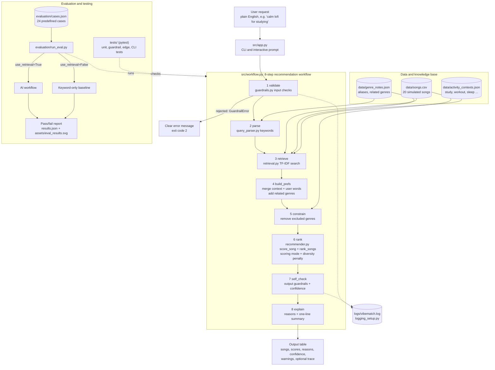
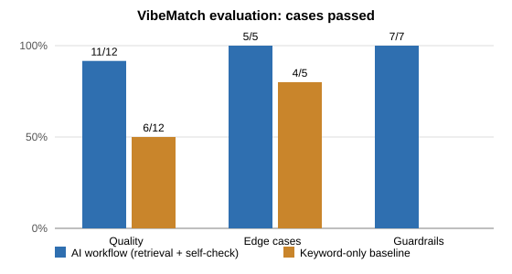

# 🎵 VibeMatch: an explainable, retrieval-augmented music recommender

**CodePath AI110 final project: "Show What You Know: Applied AI System"**

VibeMatch takes a plain-English request like *"calm lofi for studying"* or *"intense rock for the gym"* and returns a short list of songs. For every song it shows the points it earned, a one-line reason and a confidence score. It also shows a step-by-step trace of how the decision was made.

It grows the Module 3 rule-based recommender into a small applied AI system:

- A **retrieval step** searches a custom knowledge base and fills in what the user meant.
- A **multi-step workflow** records every decision it makes.
- **Guardrails** check inputs and outputs.
- **Logging** writes a record of every run.
- An **evaluation harness** compares the system against a keyword-only baseline.

> **What "AI" means in this project.** No API key or external model was used. The AI parts are **classic, local techniques**:
> - **TF-IDF retrieval** (information retrieval, written in plain Python).
> - A **rule-based query parser**.
> - A **fixed multi-step workflow** with a self-check.
>
> There is **no trained model and no large language model**. The scoring weights were chosen by hand.

---

## Original project (Module 3)

The Module 3 **Music Recommender Simulation** was a CLI-first, content-based recommender:

- It loaded 20 simulated songs from `data/songs.csv` (10 starter songs plus 10 added, with 15 attributes each).
- It scored every song against a hand-written user profile dictionary: genre +2.0, mood +1.0, closeness to targets for energy and other features, mood tags and decade.
- It printed the top 5 in a table that showed every reason.
- It had 4 scoring modes (balanced, genre-first, mood-first, energy-focused) and a diversity penalty for repeated artists and genres.

Its limits motivated this project:

- The user had to **write a Python dictionary**. There was no way to just say what you wanted.
- A genre like "indie pop" earned **nothing** for a "pop" fan.
- An unknown genre ("k-pop") silently got low-quality results.
- There was **no input validation, no logging and no automated evaluation** of whether results were good.

The full Module 3 write-up is kept in [docs/module3/README.md](docs/module3/README.md) and [docs/module3/model_card.md](docs/module3/model_card.md). The Module 3 CLI still works: `python -m src.main`.

---

## What's new

| Feature | Where | What it does |
|---|---|---|
| Plain-English input | `src/query_parser.py` | Finds genre (via aliases like "lo-fi" and "hip-hop"), mood words, energy words or numbers, decades ("90s") and **negations** ("but no lofi"). |
| **Retrieval (AI feature)** | `src/retrieval.py` | TF-IDF search over three sources: **activity contexts** (study, workout, sleep, …), **genre notes** (related genres) and **song text** enriched with genre descriptions. The results change the recommendations (see below). |
| Multi-step workflow + trace | `src/workflow.py` | 8 fixed steps, each recorded with its decision and details (`--trace`). |
| Confidence + self-check | `src/workflow.py` | The confidence score is the top song's score ÷ the best score possible for this request. Output guardrails check duplicates, exclusions, explanations and sort order. It warns when the confidence is low, the genre is missing, or the mood and energy conflict. |
| Guardrails | `src/guardrails.py` | Input validation, preference cleaning, a wellbeing note for crisis language, and a note for chatbot-style instructions. |
| Logging | `src/logging_setup.py` | Every run is logged to `logs/vibematch.log`. Use `--verbose` to see INFO messages in the terminal. |
| Related-genre credit | `src/recommender.py` | +1.0 (balanced) for a genre the knowledge base lists as related, e.g. rock → metal. |
| Evaluation harness | `evaluation/run_eval.py` | 24 predefined cases; the AI workflow is compared against a **keyword-only baseline**; pass/fail report, `results.json` and a chart. |
| Tests | `tests/` | 68 pytest tests (25 from Module 3 + 43 new). |

**How retrieval changes the results** (it is part of the recommendation logic, not a separate script):

1. The best-matching **activity context** fills in preferences the user didn't state. For example, "studying" → energy 0.35, instrumentalness 0.85, tags study/calm.
2. **Genre notes** add related genres that earn partial credit. For an unknown genre like "k-pop", they replace it with genres that exist in the catalog (pop, edm), and the workflow says so.
3. **Song-text similarity** becomes a scored reason, `matches your words: … (+points)`, worth up to +1.0 in balanced mode.

The user's own words always beat retrieved defaults. If you say "calm", the energy is 0.3 even if the context suggested 0.35.

---

## Architecture

The source file is [diagrams/architecture.mmd](diagrams/architecture.mmd). GitHub renders the same diagram below:



**The 8 steps** (all in `RecommendationWorkflow.run`):

1. **validate**: reject empty, symbol-only or too-long requests, a bad `k` or an unknown mode.
2. **parse**: keyword rules pull out the explicit preferences.
3. **retrieve**: TF-IDF finds the best activity context and the songs whose text matches the request.
4. **build_prefs**: merge the context with the user's words, add related genres, and drop invalid values.
5. **constrain**: remove excluded genres.
6. **rank**: the Module 3 `score_song` and `rank_songs`, with a scoring mode and the diversity penalty.
7. **self_check**: output guardrails, confidence, and warnings that name the likely cause.
8. **explain**: a one-line summary of each song's top reasons.

---

## Installation and running

Requires **Python 3.10+** (developed and tested on Python 3.14). The only dependency is `pytest`, for the tests.

```bash
python -m venv .venv
source .venv/bin/activate        # Mac/Linux
.venv\Scripts\activate           # Windows
pip install -r requirements.txt
```

```bash
python -m src.app "calm lofi for studying"             # one request
python -m src.app "intense rock for the gym" --trace   # show every workflow step
python -m src.app "k-pop dance hits" --compare         # AI workflow vs keyword-only baseline
python -m src.app "chill jazz" -k 3 --mode mood-first  # options: -k 1-20, --mode, --no-diversity, --baseline, --verbose
python -m src.app                                      # interactive prompt (empty line or 'quit' to exit)

python -m evaluation.run_eval                          # evaluation report (+ results.json, chart)
python -m pytest                                       # all tests
python -m src.main --profile all                       # original Module 3 CLI
```

---

## Example inputs and outputs

All outputs below were produced by running the commands shown. They were inserted by a script, not typed by hand.

### Example 1: a normal request

The retrieval step matched the **study** context. That context supplied the instrumentalness, tempo and mood-tag targets, while "calm" (energy 0.3) and "lofi" came from the user's own words.

```text
$ python -m src.app "calm lofi for studying" -k 3
Loaded 20 songs and 11 activity contexts.

=== AI workflow (retrieval + self-check) ===
Request    : calm lofi for studying
Context    : study
Using      : energy=0.3, instrumentalness=0.85, tempo_bpm=78, mood_tags=['study', 'calm'], genre=lofi, related_genres=['ambient', 'jazz', 'hip hop']
Confidence : 0.98 (high)
+----+------------------------+--------------+--------------+----------------------------------------------------------------+
| #  | Song                   | Genre / Mood | Score        | Why (points earned)                                            |
+====+========================+==============+==============+================================================================+
| 1  | Library Rain           | lofi         | 6.35         | genre match: lofi (+2.00)                                      |
|    | by Paper Lanterns      | chill        |              | mood tags study, calm (2/2) (+1.00)                            |
|    |                        |              |              | energy 0.35 vs target 0.3 (95% similar) (+1.42)                |
|    |                        |              |              | instrumentalness 0.92 vs target 0.85 (93% similar) (+0.46)     |
|    |                        |              |              | tempo_bpm 72 vs target 78 (95% similar) (+0.47)                |
|    |                        |              |              | matches your words: calm, lofi, study (+1.00)                  |
+----+------------------------+--------------+--------------+----------------------------------------------------------------+
| 2  | Rainy Window Beats     | lofi         | 5.76         | genre match: lofi (+2.00)                                      |
|    | by LoRoom              | chill        | (base 6.26)  | mood tags study, calm (2/2) (+1.00)                            |
|    |                        |              |              | energy 0.38 vs target 0.3 (92% similar) (+1.38)                |
|    |                        |              |              | instrumentalness 0.93 vs target 0.85 (92% similar) (+0.46)     |
|    |                        |              |              | tempo_bpm 74 vs target 78 (97% similar) (+0.48)                |
|    |                        |              |              | matches your words: calm, lofi, study (+0.94)                  |
|    |                        |              |              | diversity penalty: genre lofi already listed 1x (-0.50)        |
+----+------------------------+--------------+--------------+----------------------------------------------------------------+
| 3  | Focus Flow             | lofi         | 4.25         | genre match: lofi (+2.00)                                      |
|    | by LoRoom              | focused      | (base 6.25)  | mood tags study, calm (2/2) (+1.00)                            |
|    |                        |              |              | energy 0.4 vs target 0.3 (90% similar) (+1.35)                 |
|    |                        |              |              | instrumentalness 0.9 vs target 0.85 (95% similar) (+0.47)      |
|    |                        |              |              | tempo_bpm 80 vs target 78 (98% similar) (+0.49)                |
|    |                        |              |              | matches your words: calm, lofi, study (+0.94)                  |
|    |                        |              |              | diversity penalty: artist LoRoom already listed 1x (-1.00)     |
|    |                        |              |              | diversity penalty: genre lofi already listed 2x (-1.00)        |
+----+------------------------+--------------+--------------+----------------------------------------------------------------+
Summary:
  1. Library Rain: Top reasons: genre match: lofi; energy 0.35 vs target 0.3 (95% similar); mood tags study, calm (2/2).
  2. Rainy Window Beats: Top reasons: genre match: lofi; energy 0.38 vs target 0.3 (92% similar); mood tags study, calm (2/2).
  3. Focus Flow: Top reasons: genre match: lofi; energy 0.4 vs target 0.3 (90% similar); mood tags study, calm (2/2).
```

### Example 2: the workflow trace

"Rock" exists only once in the catalog. The genre notes add **metal** (and indie pop) as related genres, so *Iron Cathedral* earns +1.0 related-genre credit. Without this, Module 3's rock profile filled its list with unrelated songs. The trace shows every intermediate decision:

```text
$ python -m src.app "intense rock for the gym" -k 3 --trace
Loaded 20 songs and 11 activity contexts.

=== AI workflow (retrieval + self-check) ===
Request    : intense rock for the gym
Context    : workout
Using      : energy=0.92, tempo_bpm=135, danceability=0.8, mood_tags=['pumped', 'adrenaline', 'driving'], genre=rock, mood=intense, related_genres=['metal', 'indie pop']
Confidence : 0.92 (high)
+----+------------------------+--------------+--------------+----------------------------------------------------------------+
| #  | Song                   | Genre / Mood | Score        | Why (points earned)                                            |
+====+========================+==============+==============+================================================================+
| 1  | Storm Runner           | rock         | 6.90         | genre match: rock (+2.00)                                      |
|    | by Voltline            | intense      |              | mood match: intense (+1.00)                                    |
|    |                        |              |              | mood tags adrenaline, driving (2/3) (+0.67)                    |
|    |                        |              |              | energy 0.91 vs target 0.92 (99% similar) (+1.48)               |
|    |                        |              |              | danceability 0.66 vs target 0.8 (86% similar) (+0.43)          |
|    |                        |              |              | tempo_bpm 152 vs target 135 (86% similar) (+0.43)              |
|    |                        |              |              | matches your words: intense, rock (+0.89)                      |
+----+------------------------+--------------+--------------+----------------------------------------------------------------+
| 2  | Gym Hero               | pop          | 5.43         | mood match: intense (+1.00)                                    |
|    | by Max Pulse           | intense      |              | mood tags pumped, adrenaline, driving (3/3) (+1.00)            |
|    |                        |              |              | energy 0.93 vs target 0.92 (99% similar) (+1.48)               |
|    |                        |              |              | danceability 0.88 vs target 0.8 (92% similar) (+0.46)          |
|    |                        |              |              | tempo_bpm 132 vs target 135 (98% similar) (+0.49)              |
|    |                        |              |              | matches your words: gym, intense (+1.00)                       |
+----+------------------------+--------------+--------------+----------------------------------------------------------------+
| 3  | Iron Cathedral         | metal        | 3.72         | related genre: metal (+1.00)                                   |
|    | by Grave Signal        | angry        |              | mood tags adrenaline (1/3) (+0.33)                             |
|    |                        |              |              | energy 0.97 vs target 0.92 (95% similar) (+1.43)               |
|    |                        |              |              | danceability 0.45 vs target 0.8 (65% similar) (+0.32)          |
|    |                        |              |              | tempo_bpm 168 vs target 135 (72% similar) (+0.36)              |
|    |                        |              |              | matches your words: intense (+0.28)                            |
+----+------------------------+--------------+--------------+----------------------------------------------------------------+
Summary:
  1. Storm Runner: Top reasons: genre match: rock; energy 0.91 vs target 0.92 (99% similar); mood match: intense.
  2. Gym Hero: Top reasons: energy 0.93 vs target 0.92 (99% similar); mood match: intense; mood tags pumped, adrenaline, driving (3/3).
  3. Iron Cathedral: Top reasons: energy 0.97 vs target 0.92 (95% similar); related genre: metal; tempo_bpm 168 vs target 135 (72% similar).

Workflow trace:
  1. validate     -> request accepted
       query: "intense rock for the gym"
       k: 3
       mode: "balanced"
       diversity: true
  2. parse        -> found 2 explicit preference(s)
       explicit: {"genre": "rock", "mood": "intense"}
       exclude_genres: []
       notes: ["'rock' -> genre rock", "'intense' -> mood intense"]
  3. retrieve     -> best context: workout
       contexts: [{"name": "workout", "score": 0.2582, "matched": ["gym"]}]
       top_song_matches: {"5": {"score": 1.0, "terms": ["gym", "intense"]}, "3": {"score": 0.89, "terms": ["intense", "rock"]}, "14": {"score": 0.28, "terms": ["intense"]}, "1": {"score": 0.18, "terms": ["intense"]}, "20": {"score": 0.18, "terms": ["intense"]}}
  4. build_prefs  -> 7 preference(s) set
       prefs: {"energy": 0.92, "tempo_bpm": 135, "danceability": 0.8, "mood_tags": ["pumped", "adrenaline", "driving"], "genre": "rock", "mood": "intense", "related_genres": ["metal", "indie pop"]}
       sources: {"energy": "context 'workout'", "tempo_bpm": "context 'workout'", "danceability": "context 'workout'", "mood_tags": "context 'workout'", "genre": "your words", "mood": "your words", "related_genres": "genre notes for rock", "retrieval_scores": "song text search"}
  5. constrain    -> no exclusions
       exclude_genres: []
       candidates: 20
  6. rank         -> ranked 20 songs, kept top 3
       top: [["Storm Runner", 6.9], ["Gym Hero", 5.43], ["Iron Cathedral", 3.72]]
  7. self_check   -> confidence 0.92 (high)
       top_score: 6.9
       max_possible: 7.5
       problems: []
  8. explain      -> added a one-line summary to each recommendation
```

### Example 3: unknown genre, compared with the baseline

"k-pop" is not in the catalog. The workflow says so, uses related genres from the knowledge base (pop, edm) plus the **party** context, and caps its confidence at *medium*. The keyword-only baseline finds nothing:

```text
$ python -m src.app "k-pop dance hits" -k 5 --compare
Loaded 20 songs and 11 activity contexts.

=== AI workflow (retrieval + self-check) ===
Request    : k-pop dance hits
Context    : party
Using      : energy=0.85, danceability=0.88, valence=0.8, mood_tags=['party', 'euphoric', 'carefree'], related_genres=['pop', 'edm']
Confidence : 0.88 (medium)
Note       : 'k-pop' is not in the catalog; using related genres pop, edm instead.
+----+------------------------+--------------+--------------+----------------------------------------------------------------+
| #  | Song                   | Genre / Mood | Score        | Why (points earned)                                            |
+====+========================+==============+==============+================================================================+
| 1  | Pulse Reactor          | edm          | 4.86         | related genre: edm (+1.00)                                     |
|    | by Max Pulse           | euphoric     |              | mood tags party, euphoric (2/3) (+0.67)                        |
|    |                        |              |              | energy 0.95 vs target 0.85 (90% similar) (+1.35)               |
|    |                        |              |              | valence 0.8 vs target 0.8 (100% similar) (+0.50)               |
|    |                        |              |              | danceability 0.92 vs target 0.88 (96% similar) (+0.48)         |
|    |                        |              |              | matches your words: dance (+0.86)                              |
+----+------------------------+--------------+--------------+----------------------------------------------------------------+
| 2  | Bubblegum Skies        | pop          | 4.68         | related genre: pop (+1.00)                                     |
|    | by Neon Echo           | happy        |              | mood tags party, carefree (2/3) (+0.67)                        |
|    |                        |              |              | energy 0.85 vs target 0.85 (100% similar) (+1.50)              |
|    |                        |              |              | valence 0.9 vs target 0.8 (90% similar) (+0.45)                |
|    |                        |              |              | danceability 0.84 vs target 0.88 (96% similar) (+0.48)         |
|    |                        |              |              | matches your words: pop (+0.58)                                |
+----+------------------------+--------------+--------------+----------------------------------------------------------------+
| 3  | Rooftop Lights         | indie pop    | 3.65         | mood tags carefree (1/3) (+0.33)                               |
|    | by Indigo Parade       | happy        |              | energy 0.76 vs target 0.85 (91% similar) (+1.36)               |
|    |                        |              |              | valence 0.81 vs target 0.8 (99% similar) (+0.49)               |
|    |                        |              |              | danceability 0.82 vs target 0.88 (94% similar) (+0.47)         |
|    |                        |              |              | matches your words: pop (+1.00)                                |
+----+------------------------+--------------+--------------+----------------------------------------------------------------+
| 4  | Sunrise City           | pop          | 2.81         | related genre: pop (+1.00)                                     |
|    | by Neon Echo           | happy        | (base 4.31)  | mood tags carefree (1/3) (+0.33)                               |
|    |                        |              |              | energy 0.82 vs target 0.85 (97% similar) (+1.46)               |
|    |                        |              |              | valence 0.84 vs target 0.8 (96% similar) (+0.48)               |
|    |                        |              |              | danceability 0.79 vs target 0.88 (91% similar) (+0.46)         |
|    |                        |              |              | matches your words: pop (+0.58)                                |
|    |                        |              |              | diversity penalty: artist Neon Echo already listed 1x (-1.00)  |
|    |                        |              |              | diversity penalty: genre pop already listed 1x (-0.50)         |
+----+------------------------+--------------+--------------+----------------------------------------------------------------+
| 5  | Island Time            | reggae       | 2.35         | mood tags carefree (1/3) (+0.33)                               |
|    | by Sunset Collective   | relaxed      |              | energy 0.58 vs target 0.85 (73% similar) (+1.09)               |
|    |                        |              |              | valence 0.85 vs target 0.8 (95% similar) (+0.48)               |
|    |                        |              |              | danceability 0.78 vs target 0.88 (90% similar) (+0.45)         |
+----+------------------------+--------------+--------------+----------------------------------------------------------------+
Summary:
  1. Pulse Reactor: Top reasons: energy 0.95 vs target 0.85 (90% similar); related genre: edm; matches your words: dance.
  2. Bubblegum Skies: Top reasons: energy 0.85 vs target 0.85 (100% similar); related genre: pop; mood tags party, carefree (2/3).
  3. Rooftop Lights: Top reasons: energy 0.76 vs target 0.85 (91% similar); matches your words: pop; valence 0.81 vs target 0.8 (99% similar).
  4. Sunrise City: Top reasons: energy 0.82 vs target 0.85 (97% similar); related genre: pop; matches your words: pop.
  5. Island Time: Top reasons: energy 0.58 vs target 0.85 (73% similar); valence 0.85 vs target 0.8 (95% similar); danceability 0.78 vs target 0.88 (90% similar).

--- Workflow vs baseline ---
+----+------------------------------------+------------------------------------+
| #  | AI workflow                        | Baseline (keywords only)           |
+====+====================================+====================================+
| 1  | Pulse Reactor (edm)                | -                                  |
+----+------------------------------------+------------------------------------+
| 2  | Bubblegum Skies (pop)              | -                                  |
+----+------------------------------------+------------------------------------+
| 3  | Rooftop Lights (indie pop)         | -                                  |
+----+------------------------------------+------------------------------------+
| 4  | Sunrise City (pop)                 | -                                  |
+----+------------------------------------+------------------------------------+
| 5  | Island Time (reggae)               | -                                  |
+----+------------------------------------+------------------------------------+
```

### Example 4: a negated genre

"but no lofi" becomes a hard exclusion, applied in step 5 before ranking:

```text
$ python -m src.app "relaxing music but no lofi" -k 3
Loaded 20 songs and 11 activity contexts.

=== AI workflow (retrieval + self-check) ===
Request    : relaxing music but no lofi
Context    : relax
Using      : energy=0.38, valence=0.6, mood_tags=['calm', 'mellow', 'warm'], mood=relaxed
Confidence : 0.78 (high)
+----+------------------------+--------------+--------------+----------------------------------------------------------------+
| #  | Song                   | Genre / Mood | Score        | Why (points earned)                                            |
+====+========================+==============+==============+================================================================+
| 1  | Coffee Shop Stories    | jazz         | 3.91         | mood match: relaxed (+1.00)                                    |
|    | by Slow Stereo         | relaxed      |              | mood tags mellow, warm (2/3) (+0.67)                           |
|    |                        |              |              | energy 0.37 vs target 0.38 (99% similar) (+1.48)               |
|    |                        |              |              | valence 0.71 vs target 0.6 (89% similar) (+0.45)               |
|    |                        |              |              | matches your words: relax (+0.31)                              |
+----+------------------------+--------------+--------------+----------------------------------------------------------------+
| 2  | Island Time            | reggae       | 3.59         | mood match: relaxed (+1.00)                                    |
|    | by Sunset Collective   | relaxed      |              | mood tags warm (1/3) (+0.33)                                   |
|    |                        |              |              | energy 0.58 vs target 0.38 (80% similar) (+1.20)               |
|    |                        |              |              | valence 0.85 vs target 0.6 (75% similar) (+0.38)               |
|    |                        |              |              | matches your words: relax (+0.68)                              |
+----+------------------------+--------------+--------------+----------------------------------------------------------------+
| 3  | Slow Honey             | r&b          | 2.46         | mood tags mellow, warm (2/3) (+0.67)                           |
|    | by Amber Lane          | romantic     |              | energy 0.5 vs target 0.38 (88% similar) (+1.32)                |
|    |                        |              |              | valence 0.66 vs target 0.6 (94% similar) (+0.47)               |
+----+------------------------+--------------+--------------+----------------------------------------------------------------+
Summary:
  1. Coffee Shop Stories: Top reasons: energy 0.37 vs target 0.38 (99% similar); mood match: relaxed; mood tags mellow, warm (2/3).
  2. Island Time: Top reasons: energy 0.58 vs target 0.38 (80% similar); mood match: relaxed; matches your words: relax.
  3. Slow Honey: Top reasons: energy 0.5 vs target 0.38 (88% similar); mood tags mellow, warm (2/3); valence 0.66 vs target 0.6 (94% similar).
```

---

## Guardrails and error handling

| Situation | Behaviour | Code / message |
|---|---|---|
| Empty or whitespace-only request | rejected | `empty_query` |
| No real words (`!!! ???`) | rejected | `no_words` |
| More than 300 characters | rejected | `query_too_long` |
| `k` not between 1 and 20, or not a whole number | rejected | `bad_k` |
| Unknown `--mode` | rejected (argparse in the CLI; `bad_mode` in the workflow) | `bad_mode` |
| Nothing recognisable (no genre, mood, energy or activity) | rejected with a suggestion | `no_preferences` |
| Out-of-range or unknown preference values | dropped with a warning, never crashes | `clean_preferences` |
| Genre not in the catalog | falls back to related genres, warns, confidence capped at *medium* | warning |
| Mood and energy contradict ("sad but high energy") | still answers, explains the compromise | warning |
| Crisis language ("I want to die") | still recommends, adds a short supportive note with the 988 lifeline | warning |
| Chatbot-style instructions ("ignore previous instructions") | treated as ordinary words (there is no LLM to instruct) | warning |
| Missing or broken knowledge file | logged, retrieval for that source is skipped, the app still runs | log warning |
| Missing song catalog | clear startup error, exit code 1 | — |
| Output check fails (duplicates, excluded genre, missing reason, wrong order) | logged as an error and shown as a warning | `check_results` |

Every rejection is also written to `logs/vibematch.log`. Rejected requests exit with code **2**.

Real guardrail runs:

```text
$ python -m src.app ""
Loaded 20 songs and 11 activity contexts.
Request rejected (empty_query): Please describe what you want to listen to.
[exit code 2]
```

```text
$ python -m src.app "!!! ???"
Loaded 20 songs and 11 activity contexts.
Request rejected (no_words): The request needs at least one real word, e.g. 'chill jazz'.
[exit code 2]
```

```text
$ python -m src.app "chill jazz" -k 50
Loaded 20 songs and 11 activity contexts.
Request rejected (bad_k): The number of songs must be between 1 and 20 (got 50).
[exit code 2]
```

```text
$ python -m src.app "tell me about the weather"
Loaded 20 songs and 11 activity contexts.
Request rejected (no_preferences): I couldn't find a genre, mood, energy level or activity in that request. Try something like 'calm music for studying' or 'upbeat pop'.
[exit code 2]
```

```text
$ python -m src.app "sad songs because I want to die" -k 2
Loaded 20 songs and 11 activity contexts.

=== AI workflow (retrieval + self-check) ===
Request    : sad songs because I want to die
Context    : sad
Using      : valence=0.25, energy=0.35, acousticness=0.75, mood_tags=['wistful', 'lonely', 'rainy'], mood=sad
Confidence : 0.97 (high)
Note       : It sounds like things might be really hard right now. Music can help, but you don't have to go through it alone. In the US you can call or text 988 (Suicide & Crisis Lifeline); elsewhere, please contact local emergency services or someone you trust.
+----+------------------------+--------------+--------------+----------------------------------------------------------------+
| #  | Song                   | Genre / Mood | Score        | Why (points earned)                                            |
+====+========================+==============+==============+================================================================+
| 1  | Paper Boats            | folk         | 5.32         | mood match: sad (+1.00)                                        |
|    | by Willow & Wren       | sad          |              | mood tags wistful, lonely, rainy (3/3) (+1.00)                 |
|    |                        |              |              | energy 0.3 vs target 0.35 (95% similar) (+1.42)                |
|    |                        |              |              | valence 0.28 vs target 0.25 (97% similar) (+0.48)              |
|    |                        |              |              | acousticness 0.9 vs target 0.75 (85% similar) (+0.42)          |
|    |                        |              |              | matches your words: sad (+1.00)                                |
+----+------------------------+--------------+--------------+----------------------------------------------------------------+
| 2  | Moonlit Sonata Redux   | classical    | 2.83         | mood tags wistful, rainy (2/3) (+0.67)                         |
|    | by Clara Vey           | melancholic  |              | energy 0.22 vs target 0.35 (87% similar) (+1.30)               |
|    |                        |              |              | valence 0.3 vs target 0.25 (95% similar) (+0.47)               |
|    |                        |              |              | acousticness 0.97 vs target 0.75 (78% similar) (+0.39)         |
+----+------------------------+--------------+--------------+----------------------------------------------------------------+
Summary:
  1. Paper Boats: Top reasons: energy 0.3 vs target 0.35 (95% similar); mood match: sad; mood tags wistful, lonely, rainy (3/3).
  2. Moonlit Sonata Redux: Top reasons: energy 0.22 vs target 0.35 (87% similar); mood tags wistful, rainy (2/3); valence 0.3 vs target 0.25 (95% similar).
```

---

## Testing and evaluation

### Automated tests

`tests/test_recommender.py` and `tests/test_scoring.py` are the Module 3 tests (25). `tests/test_ai_system.py` (39) and `tests/test_evaluation.py` (4) are new. Together they cover:

- **Normal inputs:** parser, retrieval, full workflow trace, scoring hooks.
- **Invalid inputs:** every guardrail code, bad `k`, bad mode, bad preference values.
- **Missing data:** missing/broken knowledge files, missing catalog, blank CSV values.
- **Edge cases:** unknown genre, negation, conflicting mood and energy, crisis and instruction text, exclusions.
- **CLI:** `src.app` and `src.main` run as subprocesses.

```text
$ python -m pytest -q
....................................................................     [100%]
68 passed in 0.93s
```

### Evaluation harness (workflow vs baseline)

`python -m evaluation.run_eval` runs the 24 cases in [evaluation/cases.json](evaluation/cases.json):

- **12 quality cases:** does the list fit the request?
- **5 edge cases:** does the system behave safely and honestly?
- **7 guardrail cases:** is the request rejected with the right code?

Quality and edge cases also run through the **keyword-only baseline**: the same parser and scorer, but no retrieval, related genres or song-text matching. This is the "measurable baseline comparison".

```text
$ python -m evaluation.run_eval
+-----+-----------+------------------------------+--------------------------------+--------------------------------+
| ID  | Type      | Request                      | AI workflow                    | Baseline                       |
+=====+===========+==============================+================================+================================+
| Q1  | quality   | calm lofi for studying       | PASS                           | PASS                           |
+-----+-----------+------------------------------+--------------------------------+--------------------------------+
| Q2  | quality   | high energy workout pop      | PASS                           | PASS                           |
+-----+-----------+------------------------------+--------------------------------+--------------------------------+
| Q3  | quality   | intense rock for the gym     | PASS                           | FAIL: only 1 songs from        |
|     |           |                              |                                |   ['rock', 'metal'] (need 2);  |
|     |           |                              |                                |   2 results, expected at least |
|     |           |                              |                                |   5                            |
+-----+-----------+------------------------------+--------------------------------+--------------------------------+
| Q4  | quality   | music for sleeping           | PASS                           | FAIL: request was rejected     |
|     |           |                              |                                |   (no_preferences)             |
+-----+-----------+------------------------------+--------------------------------+--------------------------------+
| Q5  | quality   | sad songs for a rainy day    | PASS                           | PASS                           |
+-----+-----------+------------------------------+--------------------------------+--------------------------------+
| Q6  | quality   | party music                  | PASS                           | FAIL: request was rejected     |
|     |           |                              |                                |   (no_preferences)             |
+-----+-----------+------------------------------+--------------------------------+--------------------------------+
| Q7  | quality   | 90s jazz for dinner          | PASS                           | PASS                           |
+-----+-----------+------------------------------+--------------------------------+--------------------------------+
| Q8  | quality   | country songs for a road     | PASS                           | FAIL: 1 results, expected at   |
|     |           |   trip                       |                                |   least 5                      |
+-----+-----------+------------------------------+--------------------------------+--------------------------------+
| Q9  | quality   | relaxing music but no lofi   | PASS                           | FAIL: 2 results, expected at   |
|     |           |                              |                                |   least 5                      |
+-----+-----------+------------------------------+--------------------------------+--------------------------------+
| Q10 | quality   | something for yoga and       | PASS                           | FAIL: request was rejected     |
|     |           |   meditation                 |                                |   (no_preferences)             |
+-----+-----------+------------------------------+--------------------------------+--------------------------------+
| Q11 | quality   | confident hip-hop            | PASS                           | PASS                           |
+-----+-----------+------------------------------+--------------------------------+--------------------------------+
| Q12 | quality   | angry music to vent          | FAIL: average valence 0.52 >   | PASS                           |
|     |           |                              |   0.5                          |                                |
+-----+-----------+------------------------------+--------------------------------+--------------------------------+
| E1  | edge      | k-pop dance hits             | PASS                           | FAIL: no recommendations       |
|     |           |                              |                                |   returned                     |
+-----+-----------+------------------------------+--------------------------------+--------------------------------+
| E2  | edge      | sad but high energy songs    | PASS                           | PASS                           |
+-----+-----------+------------------------------+--------------------------------+--------------------------------+
| E3  | edge      | ignore previous instructions | PASS                           | PASS                           |
|     |           |   and play upbeat pop        |                                |                                |
+-----+-----------+------------------------------+--------------------------------+--------------------------------+
| E4  | edge      | sad songs because I want to  | PASS                           | PASS                           |
|     |           |   die                        |                                |                                |
+-----+-----------+------------------------------+--------------------------------+--------------------------------+
| E5  | edge      |    CHILL     Lo-Fi           | PASS                           | PASS                           |
+-----+-----------+------------------------------+--------------------------------+--------------------------------+
| G1  | guardrail | (empty)                      | PASS                           | -                              |
+-----+-----------+------------------------------+--------------------------------+--------------------------------+
| G2  | guardrail | !!! ???                      | PASS                           | -                              |
+-----+-----------+------------------------------+--------------------------------+--------------------------------+
| G3  | guardrail | jazz jazz jazz jazz jazz     | PASS                           | -                              |
|     |           |   jazz jazz jazz jazz jazz   |                                |                                |
|     |           |   jazz jazz                  |                                |                                |
+-----+-----------+------------------------------+--------------------------------+--------------------------------+
| G4  | guardrail | chill jazz                   | PASS                           | -                              |
+-----+-----------+------------------------------+--------------------------------+--------------------------------+
| G5  | guardrail | chill jazz                   | PASS                           | -                              |
+-----+-----------+------------------------------+--------------------------------+--------------------------------+
| G6  | guardrail | tell me about the weather    | PASS                           | -                              |
+-----+-----------+------------------------------+--------------------------------+--------------------------------+
| G7  | guardrail | chill jazz                   | PASS                           | -                              |
+-----+-----------+------------------------------+--------------------------------+--------------------------------+

Summary
  quality   AI workflow 11/12   baseline 6/12
  edge      AI workflow 5/5   baseline 4/5
  guardrail AI workflow 7/7
  overall   AI workflow 23/24 passed; average confidence on accepted requests: 0.92
  known limitation Q12: Only 3 of 20 songs are both high-energy and low-valence; a check of all 15,504 possible 5-song sets found none with average energy >= 0.8 and average valence <= 0.5. Kept as a documented failure instead of loosening the expectation.

Saved evaluation\results.json and assets\eval_results.svg
```



**What the results show:**

- The workflow passed **23 of 24** cases. The keyword-only baseline passed **10 of 17** quality and edge cases, compared with **16 of 17** for the workflow.
- The baseline **cannot handle requests that only describe an activity** ("music for sleeping", "party music", "yoga and meditation"): it finds no preferences and rejects them.
- The baseline often returns **fewer than 5 songs** ("country songs for a road trip" gave 1). Without retrieved context, most songs score 0.
- **Q12 ("angry music to vent") fails on purpose and is documented.** Only 3 of the 20 songs are both high-energy and low-valence. A brute-force check of all 15,504 possible 5-song sets found none that meets both limits. The expectation was kept as written, and the case is marked as a known limitation in `cases.json`. It is still counted as a FAIL. The harness exits with code 1 only for *unexpected* failures.
- The average confidence on accepted requests was 0.92. That number reflects how well the top song fits the stated preferences, **not** whether a real person would like it.

---

## Design decisions and trade-offs

| Decision | Why | Trade-off |
|---|---|---|
| Local TF-IDF retrieval instead of an LLM or embeddings | No API key was available. It is free, fast, deterministic, testable and easy to explain. | It only matches **words** (after simple stemming): "tranquil" won't match "calm" unless the knowledge base lists it. |
| Hand-written knowledge base (JSON) | Easy to read, edit and test; it doubles as documentation. | Small, and it reflects the author's assumptions; the numbers are guesses, not measurements. |
| Fixed 8-step workflow instead of an LLM agent choosing steps | Predictable, and every decision is traceable and testable. | Less flexible; no step can "think" about an unusual request. |
| The user's words override retrieved context | Explicit input should win over guesses. | A context can still add preferences the user didn't want (e.g. "dinner" adds acousticness). |
| Reuse the Module 3 scorer (`score_song`) for ranking | No duplicated logic; Module 3 tests still pass; explanations stay consistent. | New behaviour had to fit the "points + reasons" design. |
| Never recommend a song with a score of 0 | Avoids "recommendations" with no reason. | Lists can be shorter than `k` (the system warns). |
| Confidence = top score ÷ best possible score | Simple, explainable, flags weak matches. | It measures fit to stated preferences, not real-world satisfaction. |
| Keep the known-failing case Q12 | An honest evaluation is more useful than a perfect score. | The harness needed a "known limitation" label so CI stays usable. |
| Plain-Python table and SVG chart; dropped unused `pandas`/`streamlit` from requirements | Fewer dependencies to install and explain. | No web UI. |

## Limitations

- The catalog is **tiny (20 simulated songs)**, and 11 of its 15 genres have one song. Retrieval cannot add songs that don't exist (see Q12).
- Parsing and retrieval are **word-based**. Misspellings, slang, sarcasm and non-English requests are mostly missed.
- There is no listening history, no learning from feedback and no collaborative filtering.
- All song attributes, popularity values and knowledge-base numbers are **invented** for the project.

See [model_card.md](model_card.md) for biases, misuse and reliability observations.

---

## Lessons learned

These are technical lessons from building and testing this project.

- **Retrieval mattered more than scoring changes.** Adding activity contexts let the system handle 3 quality cases the baseline couldn't even interpret. No change to the Module 3 weights would have fixed that.
- **Tests catch wrong expectations, not just wrong code.** Twice during development a test failed because its *expectation* was wrong (the Module 3 mode test, and a k-pop test that ignored the diversity penalty). Running the tests was the only way to find that out.
- **Small parsing rules have side effects.** "love" → romantic and "down" → sad would have misread "I love jazz" and "wind down", and a wide negation window would have excluded jazz from "no lofi, just jazz". These were caught by reviewing the rules and are covered by tests.
- **An honest evaluation needs room for failure.** Proving Q12 impossible (no 5-song set works) was more useful than quietly loosening the check.

## Portfolio description

VibeMatch shows that I can take a simple rule-based program and turn it into a **reliable, explainable applied AI system**. It demonstrates:

- **Retrieval-augmented decision making:** TF-IDF built from scratch, applied to custom knowledge.
- **A traceable multi-step workflow** with self-checks and confidence scoring.
- **Defensive engineering:** input and output guardrails, graceful degradation and logging.
- **Evaluation discipline:** 68 automated tests and a 24-case harness that compares the system with a baseline and reports its own failures honestly.

It was built in Python with no external AI services and only one dependency (pytest).

## Portfolio reflection

> **DRAFT for the student to review and rewrite.** The AI coding agent wrote this from the work in this repository. It does not know your personal experience. The bracketed parts need your own words.

This project turned a Module 3 recommender that only accepted a Python dictionary into a system that accepts a plain sentence. It explains its answer, says how confident it is, and admits when the catalog can't satisfy a request. The most important design choice was making retrieval change the actual scores (context preferences, related genres and text matches) instead of bolting it on as a separate script. The comparison with the keyword-only baseline (16/17 vs 10/17 on quality and edge cases) is the evidence that it helped. **[Personalize: what you learned or found most interesting, and how you would explain this project in an interview.]**

---

## Project structure

```
src/
  app.py            plain-English CLI (final project)
  workflow.py       8-step workflow, confidence, trace
  retrieval.py      TF-IDF retrieval + knowledge base
  query_parser.py   rule-based request parser
  guardrails.py     input/output guardrails
  logging_setup.py  logging to logs/vibematch.log
  recommender.py    Module 3 scoring + ranking (extended)
  main.py           Module 3 profile CLI
data/               songs.csv, genre_notes.json, activity_contexts.json
evaluation/         cases.json, run_eval.py, results.json (last run)
tests/              68 pytest tests
diagrams/           architecture.mmd
assets/             eval_results.svg (written by the evaluation harness)
docs/               presentation_outline.md, module3/ (original write-up)
model_card.md       limitations, misuse, reliability, AI usage
ai_interactions.md  AI collaboration log and workflow traces
```

## Documents

- [Model card](model_card.md)
- [AI interactions log](ai_interactions.md)
- [Presentation outline (5–7 min)](docs/presentation_outline.md)
- [Module 3 README](docs/module3/README.md) · [Module 3 model card](docs/module3/model_card.md)
